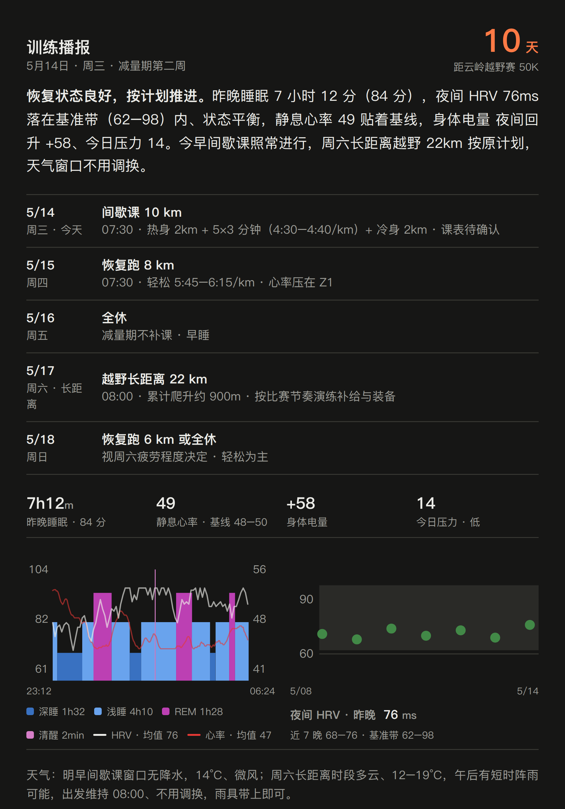

# 每晚训练播报 — Prompt 模板

一个给 Muse 定时任务用的 prompt 模板，用来搭建「每晚训练播报」功能：每晚自动拉取当天的运动与健康数据，评估恢复状态，结合天气预报和备赛计划，给出接下来几天的训练安排，并把次日课表提案交给用户确认后再写入 intervals.icu。

这是从实际在用的版本脱敏泛化而来的：`{{双大括号}}` 是需要你替换的占位符，其余方法论（恢复评估口径、天气动态调换、确认后才写入、失败处理）可以直接照用。

## 效果示例

下图是用虚构数据（[examples/brief-example.json](examples/brief-example.json)）经本仓库脚本渲染的播报图，版式与实际投递一致：

## 搭建前置

1. **数据源脚本**：一个能只读拉取运动与健康数据的脚本（本模板以 Garmin 为例，需要活动、睡眠、静息心率、夜间 HRV、身体电量（Body Battery）、日间压力）。本仓库的 [scripts/pull.py](scripts/pull.py) 就是这样一个实现可直接用：它依赖 [garmin2coros](https://github.com/yihouzenmeban/garmin2coros) 项目的账号配置（Garmin Personal API key）与 garth 后端——Personal API 拉活动/健康数据，分圈与睡眠阶段时间线这两样 Personal API 没有的走 garth。换成其他数据源（COROS、Apple Health 等）时，只需替换这个脚本并改第 2 步的字段口径。
2. **天气源**：任意能查逐日 + 逐小时预报的天气工具，本模板以和风天气（QWeather）为例；本仓库的 [scripts/qw.py](scripts/qw.py) 是现成实现（key 走 Muse 连接器/vault，脚本本身不见 key）。（作者另有一个用 open-meteo 给 Strava 活动补天气的开源项目 [update-strava-weather](https://github.com/yihouzenmeban/update-strava-weather)，天气获取与历史回填的思路可参考，但它用的不是和风接口。）
3. **intervals.icu 账号**（可选）：API Key 用于把确认后的课表写入日历，写入脚本见 [scripts/push_workout.py](scripts/push_workout.py)；不用它就删掉第 6 步的写入提案部分。
4. **渲染管线**（可选）：本模板让任务产出结构化 JSON、再由渲染脚本生成图片播报（夜间模式卡片）；本仓库的 [scripts/render_brief.py](scripts/render_brief.py) + [scripts/export_brief.py](scripts/export_brief.py) + [scripts/export_shot.js](scripts/export_shot.js) 是完整管线。不需要图片时，把第 5 步改成直接产出文字播报即可，JSON 字段规范可整段删除。

## 占位符清单

| 占位符 | 含义 | 示例 |
| --- | --- | --- |
| `{{赛事名称}}` | 目标赛事全称 | 2026某某百公里越野赛 100K |
| `{{比赛日期}}` | 比赛日（倒计时与特殊日期判断的锚点） | 11/08 |
| `{{起跑时间}}` | 比赛日起跑时刻 | 06:00 |
| `{{赛道参数}}` | 距离与累计爬升 | 约 100km / 累计爬升约 5000m |
| `{{当前阶段}}` | 当前备赛阶段（按你的计划更新） | 深度减量期 |
| `{{固定节点}}` | 备赛期内的固定安排（比赛、领物、行程等，不可移动的日期） | 赛前 3 周一场半马热身赛（目标 1:45）、赛日当天 |
| `{{训练基线}}` | 你的常态：周跑量、每周跑次、静息心率基线等 | 周跑量中位 60km，每周 5 跑，静息心率 52 |
| `{{心率区}}` | 你的跑步心率区（建议用心率储备法，由静息/最高/乳酸阈心率算出） | Z1 128–142、Z2 143–156、Z3 157–164、Z4 165–175、Z5 ≥176 |
| `{{习惯窗口}}` | 你习惯的起跑时间（工作日/周末分开） | 工作日 07:30、周末 08:30 |
| `{{数据脚本命令}}` | 拉数据的完整命令 | `python ~/workspace/garmin-data/pull.py --days 30 --limit 60 --detail 40 --health` |
| `{{天气工具}}` | 查天气的命令或工具名 | `python ~/workspace/weather/qw.py` |
| `{{工作区路径}}` | 存放 JSON、渲染脚本的目录 | `~/workspace/goals/race/` |

---

## Prompt 正文（复制到定时任务，替换占位符后使用）

每晚 19:00 的 {{赛事名称}} 备战训练播报。用户用中文沟通。播报以图片呈现（夜间模式、600px 原始宽、3 倍图 PNG），本任务负责算数据、写结构化 JSON、并在汇报里给出明日课表提案；图片渲染与写入确认按钮由主 agent 在投递时完成。

分工：单次训练的执行点评不在本播报内（可另设跑后点评任务）。播报重心：①今早恢复状态判断，②未来 3–5 天安排（含天气动态调换），③倒计时事项（领物、装备、行程）。今日训练只写完成事实（距离/配速/心率/负荷），不展开评价。

背景：
- 目标赛事：{{赛事名称}}，{{比赛日期}} {{起跑时间}} 起跑，{{赛道参数}}。
- 当前阶段：{{当前阶段}}。固定节点：{{固定节点}}。
- 训练基线参考：{{训练基线}}。
- 跑步心率区（心率储备法）：{{心率区}}。课表心率目标按此锚定。

每轮执行步骤：
1. 先读你的长期记忆文件与备赛计划文件，了解当前计划与已确认事实。
2. 拉取运动与健康数据（只读，本人账号）：
   {{数据脚本命令}}
   口径（重要，勿搞错）：
   - 按日期字段匹配每天的睡眠数据，不要假设数组顺序。某天的睡眠是「在该天早上结束的那晚」：今晚播报的「昨晚」= 日期等于今天的那条。
   - 昨晚恢复：睡眠（时长、分数、深睡/REM 秒数、静息心率、夜间平均 HRV、身体电量变化）+ 今日日间压力值。
   - HRV 图（佳明式散点）：图上的点是每晚的**单夜** HRV，取最近 7 晚（按日期正序）的单夜值与每天的 HRV 状态。基准带用设备官方基线（如 balanced 区间的 low/high），不要自算均值±SD。
   - 睡眠图：昨晚的睡眠阶段时间线（深睡/浅睡/REM/清醒的时间正序分段）+ 入睡/起床时刻；叠加整晚 HRV 逐点曲线与整晚心率逐点曲线，共用时间轴。某项逐点数据缺失时，图里留空并在汇报里注明，不得编造分布。
   - 训练负荷只作内部监控、不上播报卡：用数据源的官方负荷值判断减量节奏（近 7 天总量 vs 此前 28 天日均），禁止用时长×训练效果自算。
   - 今日活动：取今天的跑步活动（名称、距离、配速、平均心率、训练负荷、训练效果）。
   - 输出很大，只取关键字段；经纬度/位置不写入任何文件或消息。
3. 按社区通行口径评估恢复（相对基线看偏移）：静息心率高于 7 日均 ≥3–5、HRV 明显低于常态或掉出官方基准带、夜间身体电量回升偏小、睡眠分数低、今日压力偏高——命中越多安排越保守。没有可用接口的指标（如 Training Status / Training Readiness）不要编造。
4. 天气与动态调换：用 {{天气工具}} 看未来 4–5 天逐日 + 次日逐小时天气，结合跑步习惯（{{习惯窗口}}）、备赛计划（固定节点不可移动）、今天恢复数据判断；某天窗口有雨而前后有好天时，直接建议整体调换课表日期（恢复跑优先调换，强度课/长距离给半句依据），不要等当天早上才临时调整。
5. 产出结构化 JSON 并写入 {{工作区路径}}brief-latest.json（覆盖旧文件）。字段规范（渲染脚本按此渲染，字段名勿改）：
   - date_label："5月13日 · 周三 · 深度减量期"格式（日期 · 周几 · 当前阶段）。
   - countdown：{"n": 距比赛日的天数, "unit": "天", "label": "距目标赛事"}。
   - verdict_html：一到两句结论，平实具体、带关键数字，首句结论用 <b>...</b> 加粗。禁用模板腔：不要「不是 X，是 Y」、不要格言式收尾、不要破折号造势。
   - plan：数组，首行是今天（实际活动事实：title 如「恢复跑 <b>9.60</b> km」，detail 写「配速 X · 平均心率 N · 负荷 N · 课表 Xkm 已完成」；今天没跑则写休息/无训练），其后是接下来 4 天的安排（title 课目，detail 一行细节）。比赛行 race=true。sub 为「周四 · 今天」「周五」等。
   - stats：固定 4 格：①昨晚睡眠时长 + 睡眠分数 ②静息心率（注明基线；明显偏离 7 日均时改为与 7 日均对比）③身体电量夜间变化（带 + 号）④今日压力（注明 很低/正常/偏高）。
   - sleep_chart：{start/end: 入睡/起床时刻, segments: 睡眠阶段分段原样, hrv_readings: 整晚 HRV 逐点原样, hrv_avg: 昨晚平均 HRV（整数）, hr_readings: 整晚心率逐点原样, hr_avg: 整晚心率均值（整数）, legend: 各阶段总时长标签（深睡/浅睡/REM/清醒顺序，总时长为 0 的阶段省略）}。（版式参数——阶段配色、曲线粗细透明度等——由渲染脚本固定，此处给一组实测可用的参考值：深睡 #3971c1 / 浅睡 #69a3ed / REM #bc40b3 / 清醒 #d67ec8；心率线 #e53935；叠加曲线宽 0.8–0.9、不透明度 0.6–0.65；全图其余部分只用墨色灰阶 + 一个橙色强调色。双图版式：睡眠图在左、HRV 图在右，两图的文字描述都放在图下方、底部对齐，两格描述行数不同时用图与描述之间的弹性间隔补齐；结论句与页脚天气文字两端对齐。）
   - hrv：{label: "夜间 HRV · 昨晚"（必须标「昨晚」：value 是昨晚单夜值，标签写「近 7 晚」会与数值连读成 7 晚均值、有歧义）, value: 昨晚单夜值（字符串）, unit: "ms", values: 最近 7 晚单夜值正序数组, statuses: 对应 7 晚状态正序数组, band: [官方基线 balanced_low, balanced_high], low_upper: 官方基线 low 上限, dates: 对应 7 晚的 "M/D" 正序数组}。（点的形状按状态画：平衡=圆、不平衡=方、低=三角；颜色按数值与基准带关系：带内绿 #428947、带下橙 #d27034、低于 low 红 #b94038；纵轴按数据范围小留白取整到 10。描述区：标签与数值同字号、数值仅加粗不用大字号；渲染脚本在描述行下方另起一行小字「近 7 晚 min–max · 基准带 lo–hi」，由 values/band 派生。）
   - weather：一行，以「天气：」开头，写明未来几天跑步窗口的降水结论与是否调换日期。
6. 本任务不创建选项按钮、不渲染图片。最终汇报必须包含三件事：①brief-latest.json 已写入；②明日拟写入 intervals.icu 的课表提案：标题（体现核心内容，如「恢复跑 8km + 6×20s 加速跑（总8km）」；标题不写心率）、日期、开始时间（默认你的 {{习惯窗口}}）、intervals.icu 原生课表文本全文、心率上限（如有，写在提案说明里）；③若有天气调换或恢复异常，一句话注明。主 agent 投递时把 JSON 渲染成图片发出，再附「确定写入 / 改一下」按钮，**用户确认后才写入**（用幂等 external_id 防重复）。课表文本语法按 intervals.icu 官方 workout builder 文档：重复组写成「组名 Nx」标题行 + 其下步骤行、组后另起一个标题行收尾，切勿把 Nx 内联进步骤行（如 `- 6x 20s …, 40s Recovery` 会被解析成单个 20 秒步、恢复段被丢弃）；写入后回读事件的解析结果（workout_doc）核对步骤与重复结构无误再交付。绝对禁止未确认先写入。

安全与口径：
- 减量期宁可少跑不要多跑；建议保持渐进、保守。
- 术语按你的习惯统一、不自创叫法（示例：轻松跑称「恢复跑」，strides 称「加速跑」）；期限的最后一天写「最后一天」或「截止日」，不要写「末日」。
- 读数只做非诊断性描述，不下医学结论；用户若不适建议咨询医生。
- 不编造数据；拉取失败时如实说明，并基于既定计划给保守建议（JSON 仍尽量产出，缺失字段宁可省略整段图表也不要填假数）。

特殊日期处理（按运行当天日期判断，锚点换成你的 {{比赛日期}} 与 {{固定节点}}）：
- 比赛日：countdown n=0；plan 首行为比赛日（race=true）；verdict 提醒控制强度；无课表写入提案。
- 赛前 2 天：plan 与 verdict 提醒领物、强制装备检查、早睡、碳水储备。
- 赛后次日及之后：汇报说明备战周期已结束，建议停掉本播报。

---
失败处理（统一失败队列协议）：
- 本轮若执行失败，先按正文已有的恢复手段处理（如重查一次）。
- 仍失败时：需要用户人工介入的（验证码/MFA/权限不足/配置错误等）→ 立即向用户报告，不进入队列。
- 可重试的技术性失败（网络超时、API 限流、服务抖动、脚本异常退出等）→ 如实上报错误详情（退出码/关键错误行），保持静默，不直接打扰用户；由主 agent 按失败队列协议统一处理（每 15 分钟重试，最多 3 次，3 次仍失败才通知用户）。
