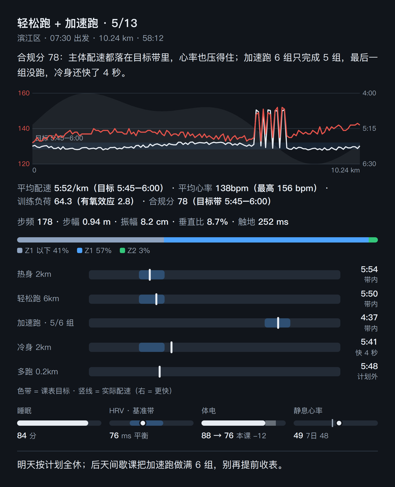

# 跑后点评 — Prompt 模板

一个事件驱动的 Muse 任务模板：用户每次跑完（或长骑完），平台的活动事件自动触发一次单次训练点评，生成结构化点评并渲染成一张图主导的点评卡投递。和每晚训练播报分工：播报管恢复判断与未来安排，点评只管刚结束的这一节课执行得怎么样。

这是从实际在用的版本脱敏泛化而来的：`{{双大括号}}` 是需要你替换的占位符，其余方法论（信号链设计、点评口径、文案禁令、卡片规范、投递兜底）可以直接照用。

## 效果示例

下图是用虚构数据（[examples/review-example.json](examples/review-example.json)）经本仓库脚本渲染的点评卡，版式与实际投递一致：



## 搭建前置

1. **信号链（事件驱动，不要用定时轮询查活动）**：整条链分三段。
   - **入队**：活动平台的 webhook（如 Strava 的 activity/create 订阅）在收到新活动时跑一个极小的 shell 脚本，只往队列文件追加一行带时间戳的信号，瞬间返回。接收器不给钩子传活动 ID——队列只是「有新活动」的信号，具体评哪个活动由点评端按状态自己对。
     ```bash
     #!/bin/bash
     QUEUE="{{工作区路径}}queue.jsonl"
     mkdir -p "$(dirname "$QUEUE")"
     printf '{"queued_at":"%s"}\n' "$(date -u +%Y-%m-%dT%H:%M:%SZ)" >> "$QUEUE"
     ```
   - **唤醒**：一个每 60 秒跑一次的轻量检测（Muse 的 hook 机制即可）：队列为空就静默；队列非空且内容哈希与上次唤醒不同才唤醒点评 worker；同一哈希 900 秒内不重复唤醒（防 worker 卡住时反复拉起）。检测只读文件、毫秒级返回，不是让 agent 每分钟轮询。
   - **消费**：worker 处理完自己删队列里已读的行、把已点评的活动 id 记进状态文件；处理期间新入队的信号保留。
2. **数据源脚本**：同播报模板，一个能只读拉活动详情（分圈、课表步骤与目标、合规分、训练负荷/效应、Body Battery 影响、逐点心率/配速/海拔序列、跑步动态）与今早健康数据（睡眠分、HRV 与状态及其基准带上下限、晨起 Body Battery 与本次活动消耗、静息心率与 7 日均值）的脚本，本仓库的 [scripts/pull.py](scripts/pull.py) 是现成实现。
3. **计划对照（可选）**：点评要对照课表判断执行偏差，计划来源可以是课表平台 API（如 intervals.icu 当天 events）或手表活动里实际挂的课表（数据脚本的 detail.workout）。对照失败不阻断点评，用手表实际课表兜底。
4. **渲染与投递**：worker 只产出结构化 JSON，渲染由主 agent 用 [scripts/render_review.py](scripts/render_review.py) 完成；投递的形态与兜底规则见文末「投递规范」。图片版用 [scripts/export_review.py](scripts/export_review.py)（与播报共用同一套截图管线与夜间主题）。

## 占位符清单

| 占位符 | 含义 | 示例 |
| --- | --- | --- |
| `{{工作区路径}}` | 存放队列、状态、点评 JSON 与渲染脚本的目录 | `~/workspace/post-run-review/` |
| `{{数据脚本命令}}` | 拉活动详情 + 健康数据的完整命令 | `python ~/workspace/garmin-data/pull.py --days 2 --health --laps 3 --detail 3` |
| `{{心率区}}` | 你的跑步心率区（建议心率储备法）及恢复区上界 | Z1 128–142、Z2 143–156、Z3 157–164（阈值）、Z4 165–175、Z5 ≥176；128 以下为恢复区 |
| `{{心率基线}}` | 静息 / 最高 / 乳酸阈心率 | 静息 52、最高 188、乳酸阈 166 |
| `{{跑步动态常态}}` | 你自己的步频/步幅/垂直振幅/触地常态（从历史活动统计） | 步频约 178、恢复跑步幅约 0.92 m、垂直振幅约 8.3 cm、触地约 255 ms |
| `{{当前阶段}}` | 当前备赛阶段与近期固定节点（点评的收尾建议按此锚定） | 目标赛事减量期，周末有一场控制强度半马 |
| `{{计划来源}}` | 课表对照的数据来源与查法 | intervals.icu API 查当天 events，查不到用手表实际挂的课表 |

---

## Prompt 正文（复制到点评 worker 的指令，替换占位符后使用）

活动点评（由活动平台 webhook 事件驱动）：用户刚产生了一个新活动，webhook 已把信号写入 {{工作区路径}}queue.jsonl（每行一个信号，只有时间戳）。请按以下步骤处理，最终把结果写进你的执行总结（主 agent 会据此渲染成点评卡投递）；没有可点评的新活动时，总结里明确写「无新点评」即可，不要编造内容。

覆盖范围：跑步、越野跑（不限距离），以及骑行（仅距离 >50 km 的才点评，短骑不触发）。

1. 记录队列当前行数 N（文件不存在或为空则 N=0）。
2. 拉取数据（只读，用户本人账号）：
   {{数据脚本命令}}
3. 读 {{工作区路径}}state.json 的 reviewed 字典。候选 = activity_id 不在 reviewed 里、开始时间在过去 36 小时内、且满足以下之一的活动（通常 0–1 个）：type 为 running/trail_running；或 type 为 cycling 且 distance_km > 50。
4. 逐个候选组织点评内容。
   跑步/越野跑，先把事实核对清楚：与计划的吻合度（计划对照：{{计划来源}}）；合规分低要能说清低在哪（配速、心率还是时长/距离偏离）；配速结构（分圈，或间歇主体段的总时长/平均心率）；心率（平均/最高，对照区间：{{心率区}}；注意数据源的分区秒数通常只统计 Z1 起的时间，Z1 以下要由总时长减各区之和得到）；代价（训练负荷、Body Battery 影响、今早的睡眠分/HRV 状态/晨起体电/静息心率）。跑步动态在常态（{{跑步动态常态}}）时不提；明显偏离常态、或长距离后段步频掉下来/触地变长时才提。越野跑步频低、含步行段，属正常。
   骑行，先把事实核对清楚：均速与最高速度、心率分布、训练负荷与训练效应、功率（没有功率计时是手表估算值，点评里要注明、只作大概参考）、总爬升、今早恢复状态。骑行不做课表对照（无合规分、无目标带）。
   文案要求（重要）：说具体的事和数，平实，像教练当面说话。不要用「不是 X，是 Y」的句式，不要格言式、金句式收尾，不要用破折号造势，不要把点评切成带标签的模板段落，不要夸大语气。结论先行，一句是一句。
   版式口径（图主导，2026-10-23 定版）：点评分两种版式。普通版式（普通训练、自由跑、骑行）：文字只写 lead + takeaway 两句，**不写 comments、不写 morning**——执行偏差写进 vs_bars、今早状态写进 recovery，文字不复述图里已有的数字。比赛版式（≥50km 或活动名/备注表明是比赛）：保留 comments 段落（3–4 段）、structure 与 morning，不写 vs_bars / recovery。渲染端在 JSON 出现 vs_bars 或 recovery 时自动不渲染 comments 与 morning 文本行，文字预算由字段保证。
5. 把点评写成结构化 JSON，覆盖写入 {{工作区路径}}last_review.json（主 agent 用 render_review.py 渲染成点评卡投递；字段缺失会被自动跳过，有多少写多少）：
   - title（如「恢复跑 · 10/23」）、subtitle（地点 · 出发时间）、distance_km、duration（如「1:06:48」）
   - lead：一句话结论，写清最关键的事实（如「配速 5:52/km，比课表目标快 13 秒，距离多出 0.4 km。合规分 58，扣分主要在这里。」）
   - chart：跑步/越野跑用 {hr, pace_min_km, elevation_m}，骑行用 {hr, speed_kmh, elevation_m}（图右轴是速度 km/h）；都原样复制该活动的逐点序列字段（已降采样、已平滑）；没有序列就省略。
   - target_pace（仅跑步）：{lo, hi}（min/km 小数，lo 为快沿、hi 为慢沿），取课表主体步的目标配速（间歇课取主体步，匀速课取该步），图上画成课表目标带；没有课表就省略。
   - vs_bars（仅普通版式的跑步）：[{label, target: {lo, hi} | null, actual}]。课表步与分圈按出现顺序配对，label 用段名+距离；重复组合并成一行并在 label 标完成进度（如「加速跑 · 1/6 组」，actual 取已完成圈平均配速）；课表之外的多余距离单独一行（target null）；无课表（自由跑）写 []，不要硬凑。
   - recovery（仅普通版式）：{sleep_score, hrv: {value, base_lo, base_hi, status}, bb: {wake, drain}, rhr: {value, avg7}}，由今早健康数据组装（bb.drain = 本次活动的 Body Battery 影响，负数原样）；缺哪项省哪项。
   - stats：四项 [{label, value, unit?, note?}]。跑步顺序固定——平均配速（note 写目标配速；越野跑 note 写坡度配速）、平均心率（note 写最高心率）、训练负荷（note 写有氧效应，保留一位小数）、合规分（note 写目标带；无合规分时换成总爬升）。骑行顺序——平均速度（unit km/h，note 写最高速度）、平均心率（note 写最高心率）、训练负荷（note 写有氧效应）、总爬升（unit m）。不要给数值配颜色。
   - dynamics（仅跑步）：{cadence, stride_m, vertical_cm, vertical_ratio, gct_ms}，取自活动详情的跑步动态，没有就省略。
   - extra_line（仅骑行）：[{k, v}]，有功率数据时写平均功率与标准化功率，没有就省略。
   - structure：仅间歇课和比赛（跑步 ≥50km）才写，并同时加 "show_structure": true；普通匀速跑和骑行省略（曲线图已经表达了结构）。内容 [{label, duration, pace, target（该段目标带字符串，没有就省略）, avg_hr, cadence}]，间歇课用「热身/主体/冷身」标注。
   - zones：[{key: below|z1|z2|z3|z4|z5, label, seconds}]，Z1 以下的 seconds = 总时长 − 各区之和，秒数为 0 的区省略。
   - comments：仅比赛版式写，3–4 段平文 [{t}]，说清心率/结构、负荷与代价、分段衰减与后程变化；普通版式省略此字段。
   - morning：仅比赛版式写，{sleep_score, hrv, hrv_status, bb_wake, rhr}，今早状态（某项没有就不写该项）；普通版式改写 recovery。
   - takeaway：一句具体的下一步，不要写成口号。当前阶段供参考：{{当前阶段}}。
   在执行总结首行写明：REVIEW_JSON: {{工作区路径}}last_review.json，并附一句纯文本版点评摘要作兜底。
6. 收尾（无论有没有候选都要做）：把候选活动 id 与日期追加进 state.json 的 reviewed 写回；从 queue.jsonl 删除前 N 行（处理期间新入队的信号保留）。数据拉取失败时：不要改 state、不要删队列、不要写 last_review.json，在总结里如实报告失败，交由上层按失败重试协议处理。

---

## 投递规范（主 agent 侧，渲染 render_review.py 时遵守）

点评卡的设计与投递有几条硬规则，都是踩过坑定下来的：

**版式**（render_review.py 已实现，改版式时别破坏）：
- 图主导：一条时间线图（配速线反转刻度 + 心率线 + 海拔淡影）承载全程形态；数字压成两行行内数字，不用瓷砖网格和彩色徽章。
- 图形与正文左右对齐：标签一律在图形外侧（曲线图的刻度在绘图区左右外侧、对照条的段名与配速值和轨道同一行）；曲线图的左右留白按刻度文字的实际宽度收紧，让刻度贴住内容边缘、绘图区尽量宽；对照条的段名列与数值列按最宽一行统一列宽（渲染时按文字宽度估算），所有轨道左右边缘对齐成一列，数值右对齐。
- 纵轴不许用数据 min-max 拉伸：心率轴按 10 bpm 取整留 20% 边距，配速轴按 15 秒取整留 30% 边距，速度轴按 5 km/h 取整——否则平坦的恢复跑看起来像过山车。
- 课表目标带画进图里（半透明带 + 左端标签），结构段行也带各自目标。
- 执行对照条（普通版式）：每段课表一条横条，色带 = 目标、竖线 = 实际，共用一条按 15 秒取整的配速标尺、右端为快；右侧数值列标注与最近带沿的偏差（带内 / 快 N 秒 / 慢 N 秒 / 计划外），条下附一行图例。
- 恢复仪表条（普通版式）：四格迷你仪表——睡眠 0–100 填充条；HRV 圆点落在基准带上（与播报的 HRV 图同一视觉语言）；体电条实色 = 本课后剩余、淡色段 = 本课消耗；静息心率点与 7 日均值刻度并排。
- 颜色语义（图片版色板「冷石板蓝」）：底 #11151b，强调蓝 #4da3ff——与心率区间条的 Z1 同色，蓝色统一承担「目标 / 基准」这类参照语义（目标带、对照条色带、HRV 基准带都是它）；心率线 #e5534b（Z5 红系），红色只给心率；实际数据一律用正文白。换掉暖橙的直接原因：橙色在深底上低透明度发闷发棕，目标带几乎读不出来。
- 心率区间条用设备官方的区间配色（这是信息色，不是装饰色）。
- 数据项整体不拆行（每项 nowrap），只在项与项之间换行；正文段落（导语、点评、收尾）两端对齐，数据行/标题/短信息行不对齐。
- 卡片内间距上下 14px、左右 16px，全图只此一层，不要再叠居中 margin 之类的第二层边距。

**投递通道**：
- HTML 卡片组件只能在用户正在对话的回合里创建；事件触发的后台投递回合里调用会被平台拒绝。后台投递时改发图片版：export_review.py 与播报共用同一套夜间出图管线（主题变量、600px 宽 3 倍图、同一截图工具），版式与卡片一致、底色用版式色板（当前 #11151b）。
- 底部留白按顶部实测留白镜像裁切，保证四边内间距视觉一致（只裁「末行 + 固定尾巴」会把下边距吃掉近 2/3）。
- 无论哪种通道，都不要退回纯文字投递——版式就是版式。
- 重新发同一张图时换文件名，聊天客户端会按文件名缓存旧图。
